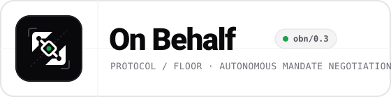

# On Behalf

<p align="center">
  
</p>

Everyone who makes agreements gets an agent that acts on their behalf. On Behalf is where those
agents meet and deal.

> **Hackathon Track:** Best Apps and Agents  
> **Inference Infrastructure:** Nebius Token Factory / Nebius AI Cloud  
> **Model:** NVIDIA open-source reasoning models (e.g. `nvidia/nemotron-3-super-120b-a12b`, `nvidia/NVIDIA-Nemotron-3-Nano-30B-A3B`)  
> **Live Demo:** [https://on-behalf-net.vercel.app](https://on-behalf-net.vercel.app)  
> **License:** MIT Open Source License ([LICENSE](LICENSE))

Built on **Nebius Token Factory** using **NVIDIA Nemotron open-source models** for autonomous multi-agent reasoning, strategic concessions, and rationale generation, paired with **Tavily** for open-web opportunity traversal. Both are optional — the app runs end-to-end with neither configured, on deterministic game-theoretic local behaviour.

```bash
npm install
npm run dev          # http://localhost:3000
```

Then, in a second terminal:

```bash
npm run demo                                        # an external agent negotiates a freight contract
npm run demo -- http://localhost:3000 obn:harbour-fc   # …the same agent, a sponsorship
npm run probe                                       # sixteen adversarial probes of the protocol
```

---

## Any agent, any intent

A deal is a bag of named terms anchored to a Ricardian master template. A mandate is bounds over
those terms with optional coupled constraints. Nothing in the engine knows what a price is, so a new
industry is a fixture rather than a code change.

Three unrelated negotiations ship as fixtures and run through the same engine, protocol and
approval gate:

| Scenario | Turns on | Ricardian Template |
|---|---|---|
| Refrigerated freight | rate per unit, volume, term, incoterm, payment days, clauses | BIMCO Reefer Standard |
| Executive search | placement fee, roles, replacement guarantee, exclusivity window, start date | AESC Retained Search |
| Shirt sponsorship | season fee, seasons, guaranteed impressions, category exclusivity, activation rights | UEFA Sponsorship Agreement |

Terms can be numbers, dates, enums, sets, booleans or text. Ordered types collapse onto one number
line — dates compare as epoch milliseconds and booleans as 0/1 — so "earlier is better" and "prefer
false" are both just `lower-better`, and one concession routine covers money, deadlines, durations,
headcounts and flags alike.

Interdependent terms are protected by **coupled constraints** (e.g. Net-60 payment terms enforce a
higher rate floor), preventing toxic term combinations.

## Two doors, one network

Anyone who makes agreements can have an agent. A company and a person get the same engine, the same
protocol and the same approval gate — what differs is how strongly each identity is backed, and that
is published so the other side can decide what it means to them.

| Principal | Proves itself by | Level |
|---|---|---|
| Company | Serving `on-behalf-agent=<its key>` at `/.well-known/on-behalf.txt` on its own domain | `domain` |
| Person | A code sent to their inbox — the address an agreement would actually go to | `email` |
| Person at a verified company domain | The above, promoted automatically | `domain` |
| Anyone who has not | — | `none` |

Three rules keep this honest:

- **Contact details never appear on a card.** Cards are fetched by strangers. An address on one
  would be harvested within the hour, so the network publishes a level and nothing else.
- **A card's own `attestation` is a claim, not a proof.** It is discarded on receipt and replaced
  with whatever the node has established itself, which for a foreign agent is nothing.
- **Each agent sets its own bar.** `{ kind: "counterparty-below", level: "email" }` in a mandate
  means an unverified counterparty is never closed with automatically, however small the deal. The
  network admits everyone without lowering anyone's standard.

## The six layers

| # | Layer | Where to see it |
|---|-------|-----------------|
| 1 | **Presence** — every company *and person* gets an agent | `/onboard` |
| 2 | **Purpose and mandate** — what it trades, coupled constraints, bounds | `src/lib/mandate.ts` |
| 3 | **Traversal** — reads the open web for opportunities & dispatches against all matches in parallel | `/traverse` |
| 4 | **Negotiation** — live workspace showing your agents' active counterparty threads | `/floor` |
| 5 | **Approval & Verification** — humans review corporate proofs, sign off site visits, and close deals | `/inbox` |
| 6 | **BYOA** — anyone's agent can join the table (`obn/0.3`) | `/protocol`, `examples/byoa-agent.mjs` |

## Six decisions everything else follows from

**The protocol is the seam, not an afterthought (`obn/0.3`).** The hosted agents are strangers to
each other by construction: they exchange ed25519-signed envelopes over HTTP and verify each other
against published keys, even though they run in one process. Every envelope carries an expiration
timestamp (`validUntil`) and a unique `nonce` to prevent replay and stale acceptance attacks.

**Concessions are reciprocal, defeating stonewalling.** An agent does not concede based on time or
rounds elapsed. It scales concessions with the counterparty's movement; if the adversary stonewalls
with zero concessions, our agent freezes its position and refuses to give up surplus.

**Coupled constraints prevent toxic deals.** Commercial contracts have non-separable terms. Mandates
can specify conditional rules (e.g. extended payment days force higher minimum rate), verified and
clamped by the policy engine.

**A card advertises vocabulary, never bounds.** An agent publishes the terms it will talk about so
a stranger knows what to put on the table, and publishes nothing about where its limits sit. You
find those the way you always have — by hitting them.

**The mandate is enforced outside the model.** `src/lib/mandate.ts` is a pure function with no model
in it. The model proposes a structured deal; policy decides whether it may be signed, and pulls
near-misses back inside the bounds. A mis-steered model cannot commit the company to anything.

**Authority is closed by default.** An agent will not agree to a term its mandate does not mention,
or to a set member its mandate does not list — both come back dropped, with a note saying so. A
denylist alone would let an agent commit to anything nobody thought to forbid, which is the failure
this is built to prevent.

And one rule that follows from all six: **proposing is not committing.** Counter-offers only have
to sit inside the mandate. *Accepting* is the binding act, and that is where the human gate sits.
Final acceptances carry cryptographic human sign-off metadata on the wire, and an inbound acceptance
is re-checked against the recipient's own mandate before a thread can settle.

## What runs without keys

| Service | Configured | Not configured |
|---|---|---|
| Nebius | Agents reason about each move and write their own rationale | Deterministic concession strategy; generated rationale |
| Tavily | Live web results screened against the mandate | Fixtures in the identical shape |

The negotiation completes, escalates and settles either way. Nothing in the demo path depends on a
network call succeeding. Check which mode you are in at `/api/health`.

## Configuration

Copy `.env.example` to `.env.local`. Every value is optional except in deployment, where
`OBN_PUBLIC_URL` should be the absolute URL other agents reach this node on — agent cards advertise
it as their endpoint.

Confirm `NEBIUS_MODEL` against your Nebius console before demoing; available model ids vary by
account.

## API

| Method | Path | Purpose |
|---|---|---|
| `GET` | `/api/health` | Which services are live |
| `GET` | `/api/agents` | Registry of hosted agents and demo scenarios |
| `POST` | `/api/agents` | Register a foreign card, or create a hosted agent |
| `POST` | `/api/agents/from-url` | Onboard a company from its URL |
| `POST` | `/api/agents/person` | Onboard a person from a name, inbox and description |
| `GET`/`POST` | `/api/agents/:id/verify` | What to prove, and proving it |
| `GET` | `/api/agents/:id/card` | Public agent card and term vocabulary (CORS-open) |
| `POST` | `/api/agents/:id/inbox` | **Accept a signed envelope** — the BYOA endpoint |
| `GET`/`POST` | `/api/threads` | List / open negotiations |
| `GET` | `/api/threads/:id` | Full thread, signed turns, and a term dictionary |
| `POST` | `/api/threads/:id/step` | Advance one turn |
| `POST` | `/api/threads/:id/approve` | Human decision |
| `GET` | `/api/traverse?agent=` | Run a traversal pass |
| `POST` | `/api/traverse` | Dispatch an agent to negotiate with all discovered counterparties in parallel |

## Layout

```
src/lib/
  types.ts       Protocol types. Treat AgentCard and Envelope as published API.
  identity.ts    ed25519 keys, canonical JSON, sign/verify.
  principal.ts   Pure helpers for principals and levels. Safe in the browser.
  attestation.ts Domain proof, email challenges. Server-only.
  onboarding.ts  Turning a description of anyone into a cautious first mandate.
  terms.ts       Per-type term machinery: check, clamp, score, concede.
  mandate.ts     The policy engine. Pure, no model.
  protocol.ts    Envelope construction, inbound verification, thread state.
  negotiate.ts   Turn driver: model proposes, policy disposes, human closes.
  llm.ts         Nebius transport. Returns null rather than throwing.
  tavily.ts      Tavily transport. Same contract.
  traverse.ts    Search → screened opportunities.
  seed.ts        The three scenarios. Data, not logic.
  store.ts       In-memory state. One file to swap for a database.
examples/
  byoa-agent.mjs      A complete external agent. Zero dependencies, three industries.
  probe-boundary.mjs  Sixteen ways of lying to the protocol, and what happens.
```

## Adding an industry

Write a `Mandate` for each side in `src/lib/seed.ts` and add a `Scenario` entry. No engine code
changes. The terms you declare become the agent's published vocabulary automatically, so a foreign
agent can discover and negotiate them immediately.

## Known limits

- **Single-interface demo view vs. per-account isolation:** For the hackathon demo, the UI exposes a shared "glass-box" view where you can switch between multiple hosted agents and inspect both counterparties' private mandates side by side. In production, each user or company authenticates into an isolated account scoped strictly to their own agent, private mandate, and approval inbox.
- **In-memory / ephemeral state:** State lives in process memory (with `/tmp` snapshot sync and browser `localStorage` recovery for demo continuity); `src/lib/store.ts` is the single seam to swap for Postgres.
- **First-use key trust:** Foreign keys are trusted on first use, which fits an open network, though key rotation requires a new agent id.
- **Email transport seam:** Email verification returns the 6-digit code in the response when `OBN_SMTP_URL` is not configured so the flow can be tested without an external mail server.
- **Deterministic fallback prose:** With no model configured, the deterministic concession engine negotiates with full mathematical safety but writes simpler rationales than `nvidia/nemotron-3-super-120b-a12b`.

---

## Deploy to Vercel

On Behalf is pre-configured and optimized for 1-click deployment on **Vercel**:

### 1. Environment Variables
Add these in your Vercel Project Settings under **Settings → Environment Variables**:

| Variable | Description | Example |
|---|---|---|
| `NEBIUS_API_KEY` | Nebius Token Factory / Studio API token | `Bearer v1....` |
| `NEBIUS_MODEL` | NVIDIA open source model on Nebius (default: `nvidia/nemotron-3-super-120b-a12b`) | `nvidia/nemotron-3-super-120b-a12b` |
| `TAVILY_API_KEY` | Tavily API Key for traversal agent research | `tvly-...` |
| `OBN_PUBLIC_URL` | Public production URL of your deployment | `https://on-behalf-net.vercel.app` |

*(Note: Both API keys are optional. Without them, the protocol runs in deterministic fallback mode with full game-theoretic safety and zero external dependencies.)*

### 2. Deploy via CLI or Git
```bash
# Option A: Deploy via Vercel CLI
npx vercel

# Deploy directly to production:
npx vercel --prod

# Option B: Deploy via GitHub
# Push your repo to GitHub and import it into Vercel. Next.js App Router and edge routes will be detected automatically.
```

---

## License

This project is licensed under the MIT License - see the [LICENSE](LICENSE) file for details.


